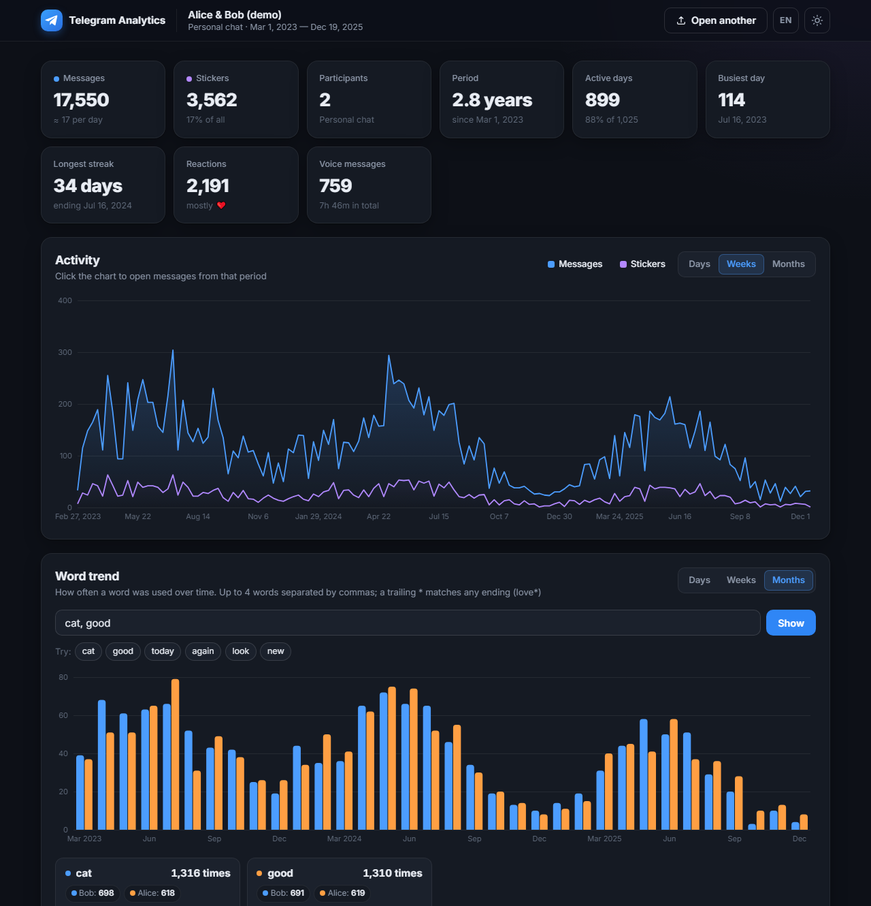
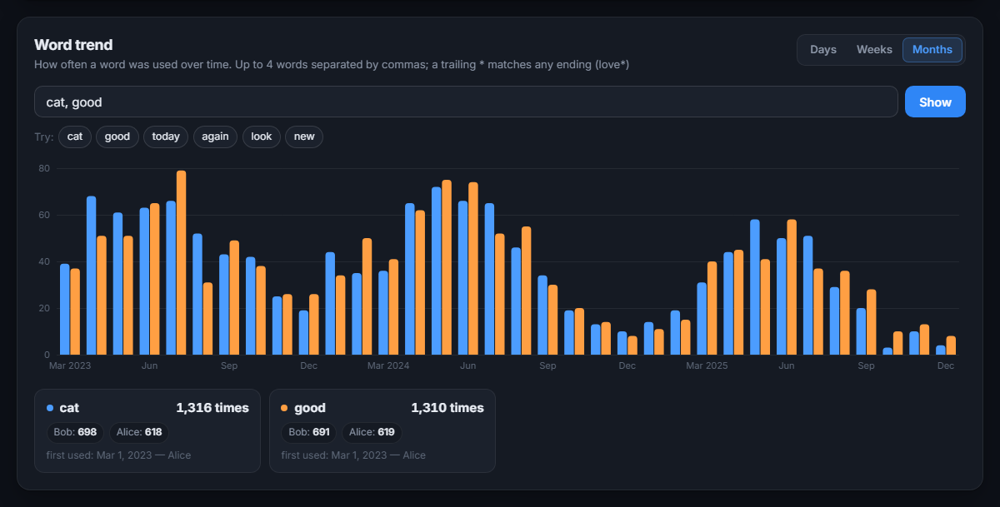
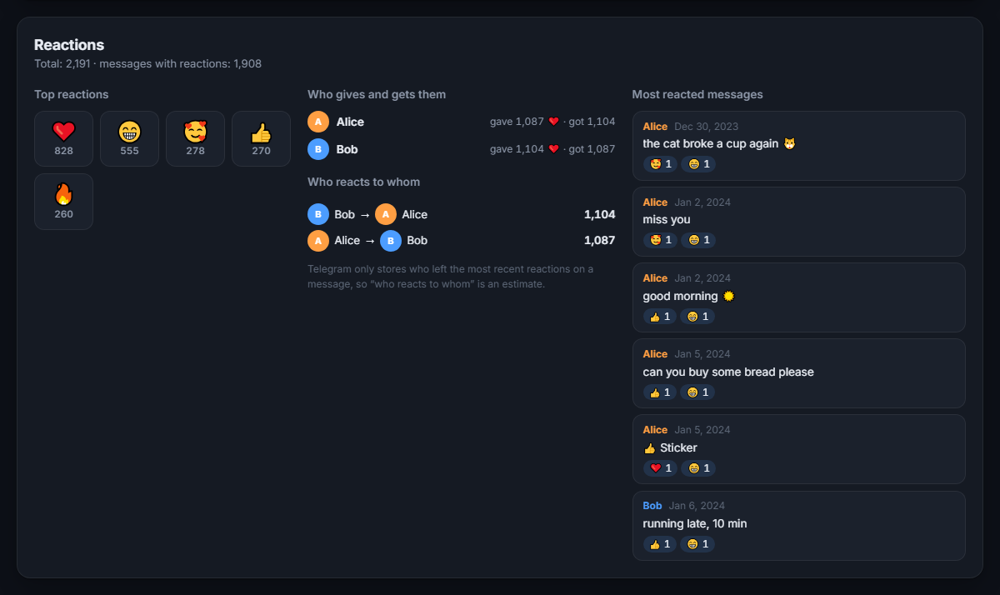
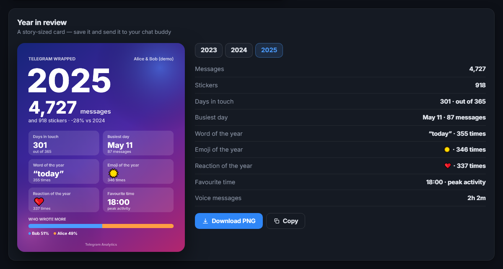
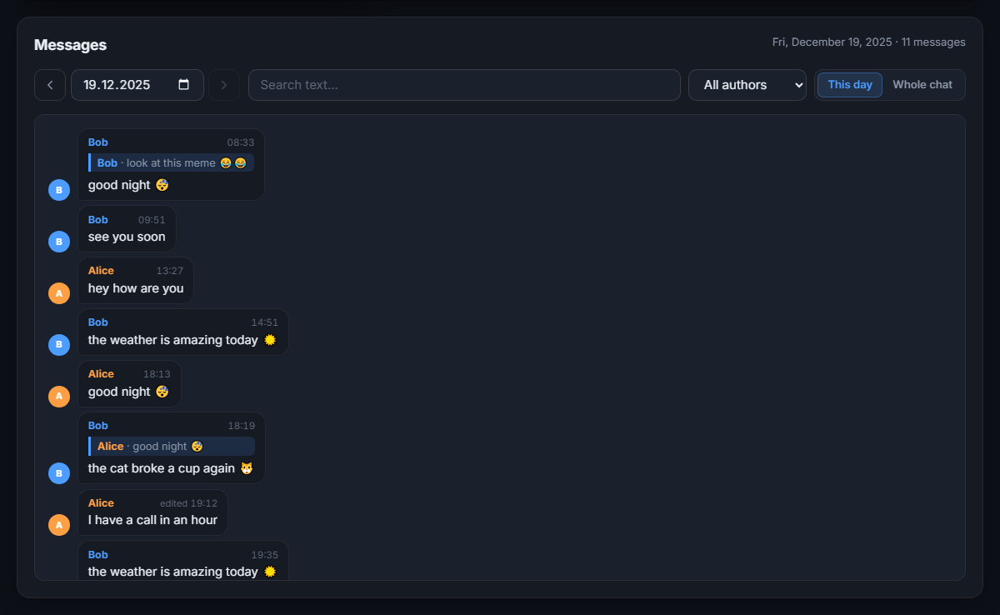

# Telegram Analytics

**English** · [Русский](README.ru.md)

Turn a Telegram chat export into a beautiful, interactive dashboard: activity charts, word trends, reactions, a shareable "year in review" card, a message browser and an AI analyst.

Everything runs **in your browser** — your chat file is never uploaded anywhere. The only optional exception is the AI assistant, which sends aggregated statistics to the API you configure.



## Features

- **Overview** — messages, stickers, participants, active days, busiest day, longest daily streak, reactions, voice messages.
- **Activity chart** — by day, week or month; hover to see who wrote the most, click to open the messages of that period.
- **Word trend** — how often a word was used over time. Compare up to 4 words, use `*` for any ending (`love*`), see who uses each word and when it was used for the first time.
- **Reactions** — top reactions, who gives and receives the most, who reacts to whom, the most reacted messages.
- **Year in review** — a story-sized (1080×1350) card with the year's highlights: word, emoji and reaction of the year, busiest day, favourite time, who wrote more. Download as PNG or copy to clipboard.
- **Rhythm** — weekday × hour heatmap.
- **Participants** — messages, stickers, media, voice minutes, average message length, who starts conversations, median reply time, favourite emoji.
- **Top words and emoji** — filter by participant, click a word to see its trend.
- **Message browser** — read any day, jump between active days, search the whole chat, filter by author, follow replies.
- **AI analyst** — ask questions about your chat; works with any OpenAI-compatible API (Groq, OpenAI, OpenRouter, LM Studio, Ollama…).
- **Russian and English UI**, dark and light themes, mobile-friendly layout.
- Supports both a single-chat export and a **full account export** (you pick the chat).

| Word trend | Reactions |
|---|---|
|  |  |

| Year in review | Message browser |
|---|---|
|  |  |

## Quick start

Requirements: Python 3.8+ (only for the local server; no packages to install).

```bash
git clone https://github.com/araluga/telegram-chat-analytics.git
cd telegram-chat-analytics
python server.py
```

Open <http://localhost:8000> and drop your `result.json` onto the page — or click **Try it with demo data** to explore the app with a generated chat.

You can also open `index.html` directly in the browser without the server: all statistics work, and the AI assistant will call the API directly with the key from its settings.

### How to export a chat

1. Open **Telegram Desktop** → the chat → **⋮** menu → **Export chat history**.
2. Untick photos/videos (not needed) and choose the **JSON** (machine-readable) format.
3. Drop the resulting `result.json` into the app.

A full account export (*Settings → Advanced → Export Telegram data*, JSON) works too — the app will show a list of chats.

## AI assistant

Open the ✦ button in the bottom-right corner → ⚙ settings and enter:

| Setting | Example |
|---|---|
| API key | `gsk_...` (Groq), `sk-...` (OpenAI) |
| Model | `llama-3.3-70b-versatile` |
| Base URL | `https://api.groq.com/openai/v1` |

The key is stored only in your browser (`localStorage`). By default the AI receives **only aggregated statistics** (counts, top words, activity). Sending the last 150 messages is an opt-in checkbox.

To use a default key without entering it in the browser, create a `.env` file next to `server.py` (see `.env.example`):

```env
GROQ_API_KEY=gsk_your_key_here
```

The server uses this key only for requests to the official Groq API address.

### Server options

| Variable | Default | Description |
|---|---|---|
| `PORT` | `8000` | Port to listen on |
| `HOST` | `127.0.0.1` | Interface to bind (local-only by default) |
| `GROQ_API_KEY` | — | Default AI key (also read from `.env`) |

## Privacy and security

- The export is parsed and analysed entirely in the browser.
- The server binds to `127.0.0.1`, rejects cross-origin API requests, never serves `.env`/`.py` files and does not forward its own key to third-party hosts.
- Chat text is rendered with escaping; links are restricted to `http(s)` and `mailto`.

## Project structure

```
index.html   – markup
style.css    – styles (dark/light themes)
main.js      – parsing, statistics, charts, UI, i18n, AI client
demo.js      – deterministic demo chat generator
server.py    – static server + AI proxy (standard library only)
```

No build step and no dependencies — plain HTML, CSS and JavaScript.

## License

[MIT](LICENSE)
