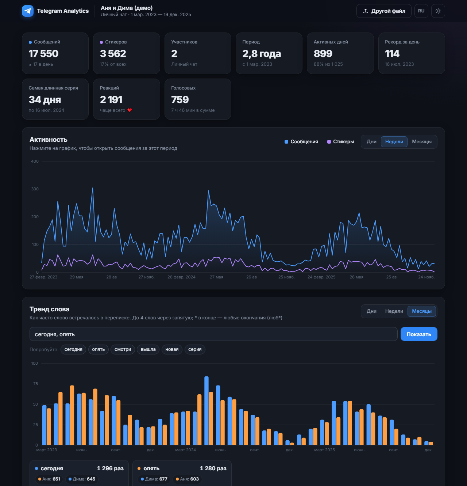
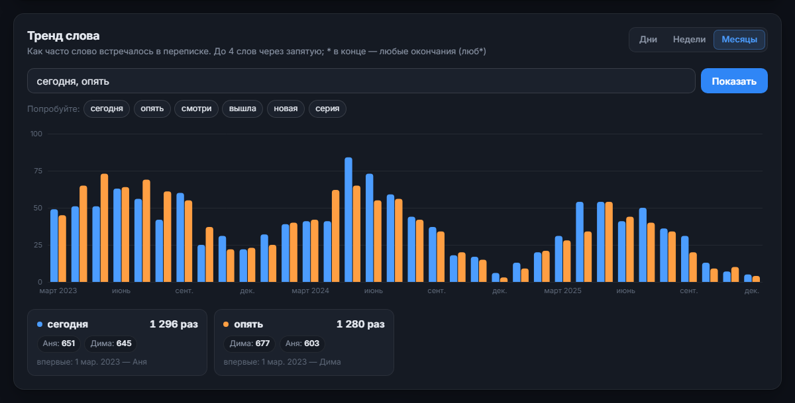
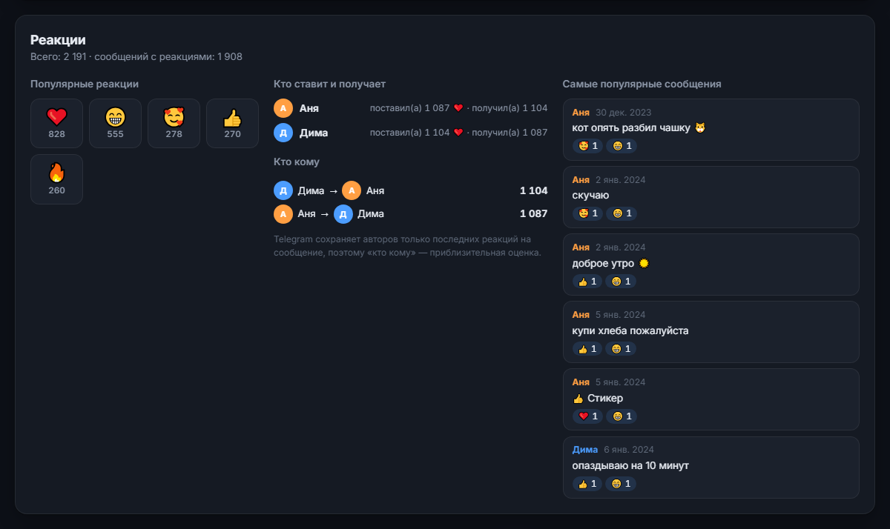
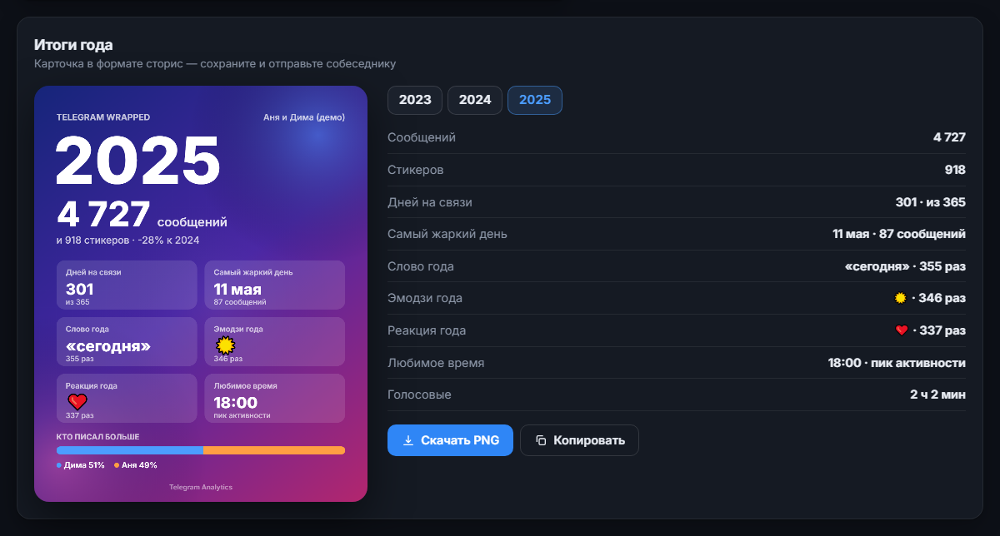
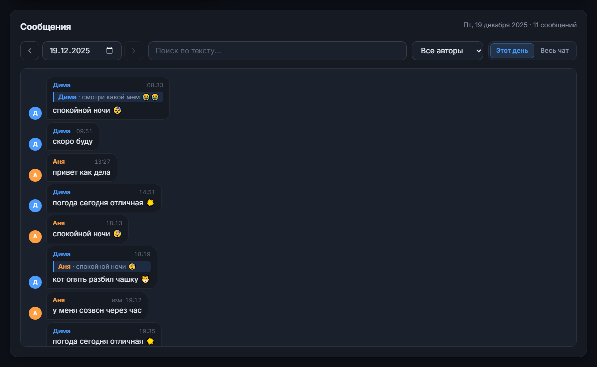

# Telegram Analytics

[English](README.md) · **Русский**

**▶ Онлайн-версия: <https://araluga.github.io/telegram-chat-analytics/?lang=ru>** — без установки; добавьте к ссылке `&demo`, чтобы открыть демо-чат.

Превращает экспорт чата Telegram в красивый интерактивный дашборд: графики активности, тренды слов, реакции, карточка «Итоги года», просмотр переписки и ИИ-аналитик.

Всё работает **прямо в браузере** — файл с перепиской никуда не загружается. Единственное (необязательное) исключение — ИИ-ассистент: он отправляет агрегированную статистику в API, который вы сами укажете.



## Возможности

- **Сводка** — сообщения, стикеры, участники, активные дни, рекорд за день, самая длинная серия, реакции, голосовые.
- **График активности** — по дням, неделям или месяцам; при наведении видно, кто писал больше, по клику открываются сообщения за этот период.
- **Тренд слова** — как часто слово встречалось со временем. Можно сравнить до 4 слов, `*` в конце — любые окончания (`люб*`); видно, кто и сколько раз его писал и когда оно появилось впервые.
- **Реакции** — популярные реакции, кто больше ставит и получает, кто кому ставит, самые «залайканные» сообщения.
- **Итоги года** — карточка в формате сторис (1080×1350): слово, эмодзи и реакция года, самый жаркий день, любимое время, кто писал больше. Можно скачать PNG или скопировать в буфер обмена.
- **Ритм общения** — тепловая карта «день недели × час».
- **Участники** — сообщения, стикеры, медиа, минуты голосовых, средняя длина сообщения, кто начинает разговор, медианное время ответа, любимые эмодзи.
- **Топ слов и эмодзи** — фильтр по участнику; клик по слову строит его тренд.
- **Просмотр сообщений** — любой день, переход между активными днями, поиск по всему чату, фильтр по автору, переход к сообщению, на которое ответили.
- **ИИ-аналитик** — вопросы о вашей переписке; подходит любой OpenAI-совместимый API (Groq, OpenAI, OpenRouter, LM Studio, Ollama…).
- **Интерфейс на русском и английском**, тёмная и светлая темы, адаптация под телефон.
- Поддерживается и экспорт одного чата, и **полный экспорт аккаунта** (чат выбирается из списка).

| Тренд слова | Реакции |
|---|---|
|  |  |

| Итоги года | Просмотр сообщений |
|---|---|
|  |  |

## Быстрый старт

Нужен Python 3.8+ (только для локального сервера; ничего устанавливать не надо).

```bash
git clone https://github.com/araluga/telegram-chat-analytics.git
cd telegram-chat-analytics
python server.py
```

Откройте <http://localhost:8000> и перетащите на страницу свой `result.json` — или нажмите **«Попробовать на демо-данных»**, чтобы посмотреть приложение на сгенерированном чате.

Можно открыть `index.html` и без сервера, просто как файл: вся статистика работает, а ИИ-ассистент будет обращаться к API напрямую с ключом из настроек.

### Как выгрузить чат

1. **Telegram Desktop** → нужный чат → меню **⋮** → **Экспорт истории чата**.
2. Снимите галочки с фото и видео (они не нужны) и выберите формат **JSON** (машиночитаемый).
3. Перетащите полученный `result.json` в приложение.

Полный экспорт аккаунта (*Настройки → Продвинутые настройки → Экспорт данных из Telegram*, формат JSON) тоже подходит — приложение покажет список чатов.

## ИИ-ассистент

Нажмите кнопку ✦ в правом нижнем углу → ⚙ настройки и укажите:

| Настройка | Пример |
|---|---|
| API-ключ | `gsk_...` (Groq), `sk-...` (OpenAI) |
| Модель | `llama-3.3-70b-versatile` |
| Base URL | `https://api.groq.com/openai/v1` |

Ключ хранится только в вашем браузере (`localStorage`). По умолчанию ИИ получает **только агрегированную статистику** (числа, топ слов, активность). Отправка последних 150 сообщений включается отдельной галочкой.

Чтобы не вводить ключ в браузере, создайте рядом с `server.py` файл `.env` (пример — `.env.example`):

```env
GROQ_API_KEY=gsk_ваш_ключ
```

Сервер использует этот ключ только для запросов на официальный адрес Groq.

### Параметры сервера

| Переменная | По умолчанию | Описание |
|---|---|---|
| `PORT` | `8000` | Порт |
| `HOST` | `127.0.0.1` | Интерфейс (по умолчанию доступен только с этого компьютера) |
| `GROQ_API_KEY` | — | Ключ ИИ по умолчанию (также читается из `.env`) |

## Приватность и безопасность

- Экспорт разбирается и анализируется полностью в браузере.
- Сервер слушает только `127.0.0.1`, отклоняет API-запросы с чужих сайтов, не отдаёт файлы `.env`/`.py` и не пересылает свой ключ на сторонние адреса.
- Текст переписки выводится с экранированием; ссылки разрешены только `http(s)` и `mailto`.

## Структура проекта

```
index.html   – разметка
style.css    – стили (тёмная и светлая темы)
main.js      – разбор экспорта, статистика, графики, интерфейс, локализация, клиент ИИ
demo.js      – генератор демо-чата
server.py    – статический сервер + прокси для ИИ (только стандартная библиотека)
```

Без сборки и зависимостей — чистые HTML, CSS и JavaScript.

## Лицензия

[MIT](LICENSE)
